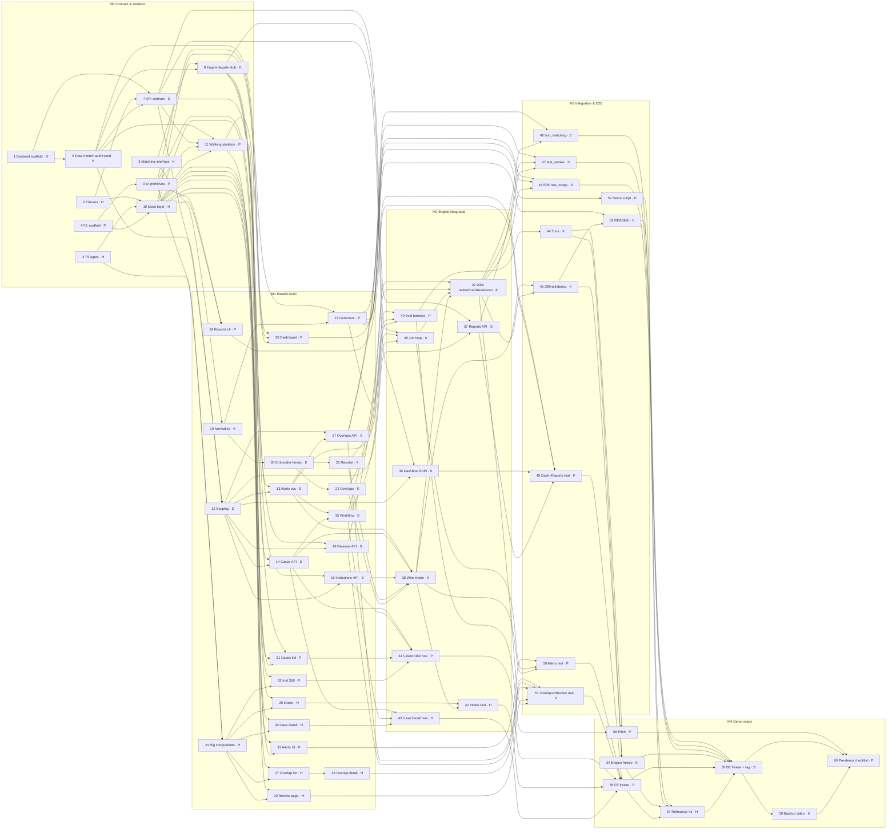
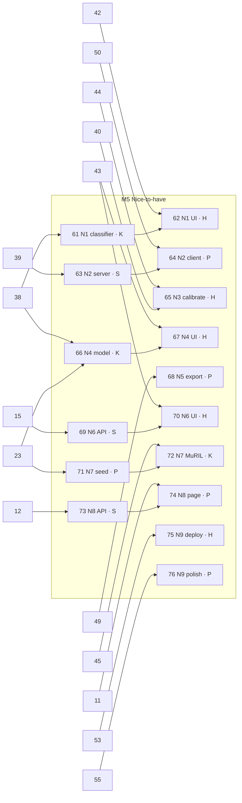

# Unicomply — Issues Plan

SIH 2026 · PS 26264 · Plan for the GitHub issues, milestones and owners. Source of truth: `docs/Unicomply PRD.md`, base patterns: `docs/HACKATHON_PRD.md`.

**Status: created on GitHub.** Every number in this document is the real issue number on [krishnasharma1493/Unicomply](https://github.com/krishnasharma1493/Unicomply/issues): #1–#76 are the work issues and [#77 Unicomply roadmap](https://github.com/krishnasharma1493/Unicomply/issues/77) is the tracking checklist. Issues were created in dependency order, so every "Depends on" points to a lower number. Each issue is assigned to its owner, placed in its milestone (M0–M5) and labelled as in the tables below.

## Team & ownership

| Handle | Short | Area |
|---|---|---|
| krishnasharma1493 | **K** | Signature feature: `app/matching/` + wiring the engine into intake / review / overlap-upsert |
| singh2suryansh | **S** | Platform backend: data model, auth, scoping, workflow, all non-matching APIs, job loop, backend test suites |
| priyanshigupta0729-droid | **P** | Frontend: shell, Dashboard, Cases, Institution 360, Alerts, Reports. **Data & numbers track:** generator, eval harness, pitch deck |
| singh-shreyas | **H** | Frontend: contract fixtures/types/mocks, signature UI (Intake, Case Detail, Overlap Center, Match Review). **Demo track:** script, README, rehearsal, video |

### K — krishnasharma1493 (signature engine)
- **Responsibilities:** PRD §4.4–4.5 end to end. This covers normalization, the Embedder with TF-IDF fallback, MatchIndex, `resolve_institution()`, overlap scoring, levels, tiers, complete-linkage clusters, reasons, `thresholds.json`, and the engine service façade that platform code calls, along with its real wiring into intake, review decisions, transfers and the job re-scan. K does not own the generator, seed/reset, the eval harness, the general test suites or end-to-end integration.
- **Issues:** M0 #5, #8 · M1 #19, #20, #21, #22 · M2 #38, #39 · M3 #44, #45 · M4 #54 · M5 #61, #66, #72
- **Provides:** the matching dataclasses and signatures (#5), plus a stub façade (#8) so S can wire endpoints in M0/M1. After that, the real engine (#38, #39), frozen thresholds (#44) and offline parity (#45).
- **Needs:** config, models and the tiny seed (#1, #6, from S); `abbreviations.json` is K's own. Synthetic data and ground truth come from P (#23), the eval harness from P (#40), and the alert helper from S (#13).

### S — singh2suryansh (platform backend)
- **Responsibilities:** backend scaffold, the §4.1 data model, persona auth, scoping and `require_roles`, the Pydantic API contract and stub routers, and the workflow state machine. Also the case, institution, meta, overlap-decision, review, alerts, dashboard and reports APIs, the job loop, CSV export, all backend test suites (workflow, smoke, matching, scope), and the backend freeze.
- **Issues:** M0 #1, #6, #7 · M1 #12–#18 · M2 #35, #36, #37 · M3 #46, #47, #48 · M4 #58 · M5 #63, #69, #73
- **Provides:** the running API, `/docs` as the live contract, `create_alert()`, scoping, and the `demo-ready` tag.
- **Needs:** contract fixtures from H (#2) to serve from stubs, and the engine façade from K (#8; the stub first, the real one in #38/#39).

### P — priyanshigupta0729-droid (frontend + data/eval/pitch)
- **Responsibilities:** frontend scaffold, UI primitives, the walking skeleton, and the Dashboard, Cases list, Institution 360, Alerts (bell + page), Reports and Admin (demo reset) pages. Switches each of those from mocks to the real API. Supporting Python: the synthetic generator with ground truth and the accuracy eval harness. Demo: pitch deck with the accuracy slide, the frontend freeze audit, and the pre-demo checklist.
- **Issues:** M0 #4, #9, #11 · M1 #23, #30–#34 · M2 #40, #41 · M3 #49, #50 · M4 #55, #56, #60 · M5 #64, #68, #71, #74, #76
- **Provides:** the app shell and primitives that H's pages render inside, the full synthetic dataset (to K, S and H), and `eval_results.md` (to K for tuning, and to the slides).
- **Needs:** fixtures, types and the mock layer from H (#2, #3, #10); APIs from S; the engine from K for the eval.

### H — singh-shreyas (frontend + contract mocks + demo)
- **Responsibilities:** contract fixtures, TS contract types and the mock-API layer (so the UI exists before the backend). Signature UI components plus the Intake, Case Detail (actions and timeline), Overlap Center list and detail, and Match Review pages. Switches each of those to the real API. Demo: the §10A script, README with a clean-clone test, the full rehearsal and the backup video.
- **Issues:** M0 #2, #3, #10 · M1 #24–#29 · M2 #42, #43 · M3 #51, #52, #53 · M4 #57, #59 · M5 #62, #65, #67, #70, #75
- **Provides:** the shared contract fixtures (used by both S's stubs and the FE mocks), types, the mock layer, and the signature components P reuses (LinkedCaseCard, OverlapBanner).
- **Needs:** the scaffold and primitives from P (#4, #9); APIs and the engine for the switches; tags and freezes for the rehearsal.

## Full issue table

Labels: `must-have` sits on every M0–M4 issue and `nice-to-have` on every M5 issue. They are left out of the table below to keep it short.

### Milestone 0 — Contract & skeleton
| # | Title | Owner | Labels | Depends on | §1A |
|---|---|---|---|---|---|
| 1 | Backend scaffold: FastAPI app, config, error contract, health | S | area:backend, type:feature, contract | — | M13 |
| 2 | Contract fixtures: mock JSON for every §5 endpoint (hero story) | H | area:frontend, area:data, type:feature, contract | — | M13 |
| 3 | TypeScript contract types mirroring §5 schemas | H | area:frontend, type:feature, contract | — | M13 |
| 4 | Frontend scaffold: Vite + TS strict, Axios client, auth provider, routes | P | area:frontend, type:feature | — | M13 |
| 5 | Matching interface: dataclasses, signatures, StubEngine | K | area:matching, type:feature, contract | — | M4 |
| 6 | Data model (§4.1), persona auth, tiny seed + reset | S | area:backend, area:data, type:feature | 1 | M1, M12 |
| 7 | API contract: Pydantic schemas + stub routers for every §5 endpoint | S | area:backend, type:feature, contract | 1, 2, 6 | M13 |
| 8 | Engine service façade (stub): the platform ↔ engine seam | K | area:matching, type:feature, contract | 5, 6 | M3, M4 |
| 9 | UI primitives: chips, SlaBadge, page states, date utils | P | area:frontend, type:feature | 4 | M13 |
| 10 | Frontend mock-API layer (VITE_USE_MOCKS) | H | area:frontend, type:feature, contract | 2, 3, 4 | M13 |
| 11 | Walking skeleton: persona login → shell → cases list → admin reset | P | area:frontend, type:integration | 6, 7, 9, 10 | M1, M13 |

### Milestone 1 — Parallel feature build
| # | Title | Owner | Labels | Depends on | §1A |
|---|---|---|---|---|---|
| 12 | Scoping & permissions: scope_cases, 404 loader, require_roles, summary cards | S | area:backend, type:feature | 6, 7 | M1 |
| 13 | Alerts service + API (create_alert with dedupe, bell endpoints) | S | area:backend, type:feature | 7, 12 | M10 |
| 14 | Cases API: search & filters, detail, intake | S | area:backend, type:feature | 8, 12 | M3, M7, M9 |
| 15 | Case workflow state machine + test_workflow.py | S | area:backend, type:feature, type:test | 13, 14 | M7 |
| 16 | Institutions & meta API: search, Institution 360, resolve preview | S | area:backend, type:feature | 8, 12 | M2, M3 |
| 17 | Overlap Center API: list, detail, decisions | S | area:backend, type:feature | 12, 13 | M5 |
| 18 | Match review API: queue + decide | S | area:backend, type:feature | 8, 12 | M6 |
| 19 | Normalization, abbreviations.json and thresholds loader | K | area:matching, type:feature | 5 | M4 |
| 20 | Embedder (model \| TF-IDF) + MatchIndex | K | area:matching, type:feature | 19 | M4 |
| 21 | resolve_institution(): exact tier, location veto, scoring, decision, reasons | K | area:matching, type:feature | 20 | M3, M4 |
| 22 | detect_overlaps(): pair score, levels, tiers, complete-linkage clusters, reasons | K | area:matching, type:feature | 20 | M4, M5 |
| 23 | Synthetic data generator + ground truth + full seed | P | area:data, type:feature | 6, 19 | M12 |
| 24 | Signature UI components: OverlapBanner, WhyFlagged, CandidateList, LinkedCaseCard | H | area:frontend, type:feature | 3, 9 | M3, M5 |
| 25 | Intake page with live candidate panel | H | area:frontend, type:feature | 10, 24 | M3 |
| 26 | Case Detail page: timeline, action dialogs, overlap guard | H | area:frontend, type:feature | 10, 24 | M7 |
| 27 | Overlap Center list page | H | area:frontend, type:feature | 10, 24 | M5 |
| 28 | Overlap detail page: side-by-side clusters + decisions | H | area:frontend, type:feature | 27 | M5 |
| 29 | Match Review page | H | area:frontend, type:feature | 10, 24 | M6 |
| 30 | Dashboard page: KPI cards, workload, ageing, institutions | P | area:frontend, type:feature | 9, 10, 11 | M8 |
| 31 | Cases list page: search & filters | P | area:frontend, type:feature | 9, 10, 11 | M9 |
| 32 | Institution 360 page: search + profile | P | area:frontend, type:feature | 10, 24 | M2 |
| 33 | Alerts: bell + page (grouped, severity-sorted) | P | area:frontend, type:feature | 10, 11 | M10 |
| 34 | Reports page: picker, chart, table, CSV download | P | area:frontend, type:feature | 9, 10 | M11 |

### Milestone 2 — Signature engine integrated
| # | Title | Owner | Labels | Depends on | §1A |
|---|---|---|---|---|---|
| 35 | Job loop: SLA warning/breach, reminders, re-scan hook | S | area:backend, type:feature | 8, 13, 15 | M10 |
| 36 | Dashboard API: summary, workload, ageing, institutions | S | area:backend, type:feature | 7, 12 | M8 |
| 37 | Reports API + CSV export | S | area:backend, type:feature | 7, 12 | M11 |
| 38 | Wire engine into intake + resolve preview (one-transaction overlap upsert) | K | area:matching, type:integration | 13, 14, 16, 21, 22 | M3, M4 |
| 39 | Wire engine into review decisions, transfers and job re-scan | K | area:matching, type:integration | 15, 18, 35, 38 | M4, M6 |
| 40 | Accuracy eval harness: python -m app.eval → eval_results.md | P | area:data, type:test | 21, 22, 23 | M12 |
| 41 | Switch Cases list + Institution 360 to the real API | P | area:frontend, type:integration | 14, 16, 31, 32 | M2, M9 |
| 42 | Switch Intake to the real engine | H | area:frontend, type:integration | 25, 38 | M3, M4 |
| 43 | Switch Case Detail + workflow actions to the real API | H | area:frontend, type:integration | 14, 15, 26 | M7 |

### Milestone 3 — Integration & end-to-end
| # | Title | Owner | Labels | Depends on | §1A |
|---|---|---|---|---|---|
| 44 | Tune weights & thresholds on the dev split; freeze thresholds.json | K | area:matching, type:feature | 40 | M4, M12 |
| 45 | Offline & latency hardening: TF-IDF parity, index cache, < 2 s intake | K | area:matching, type:feature | 38, 39 | M4 |
| 46 | test_matching.py: §10 matching rules suite | S | area:backend, area:matching, type:test | 23, 39 | M4 |
| 47 | test_smoke.py: §10 Swagger run order end to end (TF-IDF) | S | area:backend, type:test, type:integration | 17, 37, 39 | M13 |
| 48 | E2E: test_scope.py, the hero path across all 5 personas | S | area:backend, type:test, type:integration | 17, 23, 39 | M1 |
| 49 | Switch Dashboard + Reports to the real API | P | area:frontend, type:integration | 30, 34, 36, 37 | M8, M11 |
| 50 | Switch Alerts bell + page to real alerts (engine + job loop) | P | area:frontend, type:integration | 33, 35, 38 | M10 |
| 51 | Switch Overlap Center + Match Review to the real API | H | area:frontend, type:integration | 17, 18, 28, 29, 39 | M5, M6 |
| 52 | Demo script (§10A): steps, hero text file, rubric mapping | H | area:demo, type:docs | 23 | M13 |
| 53 | README + clean-clone setup (≤ 10 min, tested by a non-author) | H | area:demo, type:docs | 23, 45 | M13 |

### Milestone 4 — Demo-ready (feature freeze, rehearsals, backup video)
| # | Title | Owner | Labels | Depends on | §1A |
|---|---|---|---|---|---|
| 54 | Signature engine freeze: failure-mode checks + hero determinism | K | area:matching, type:test | 44, 45 | M4 |
| 55 | Frontend freeze: §8 checklist + loading/empty/error audit | P | area:frontend, type:test | 41, 42, 43, 49, 50, 51 | M13 |
| 56 | Pitch assets: deck, accuracy slide from eval_results.md, architecture, Q&A | P | area:demo, type:docs | 40, 44 | M13 |
| 57 | Full demo rehearsal ×3 against §10A + failure drills | H | area:demo, type:test, type:integration | 52, 53, 54, 55 | M1–M13 |
| 58 | Backend freeze: §6 checklist, lockfiles, demo-ready tag | S | area:backend, type:test | 46, 47, 48, 54, 55, 57 | M13 |
| 59 | Backup demo video (steps 2–8) | H | area:demo, type:docs | 58 | M13 |
| 60 | Pre-demo checklist executed + backup laptop ready | P | area:demo, type:docs | 56, 58, 59 | M13 |

### Milestone 5 — Nice-to-have (branches off `demo-ready`; merged only if smoke + one rehearsal still pass, then re-tag)
| # | Title | Owner | Labels | Depends on | §1A |
|---|---|---|---|---|---|
| 61 | N1: category classifier (TF-IDF + LinearSVC) + classify endpoint | K | area:matching, type:feature | 38 | N1 |
| 62 | N1: category suggestion in Intake | H | area:frontend, type:feature | 42, 61 | N1 |
| 63 | N2: real-time server events (python-socketio) | S | area:backend, type:feature | 39 | N2 |
| 64 | N2: live alerts in the browser (socket.io-client) | P | area:frontend, type:feature | 50, 63 | N2 |
| 65 | N3: python -m app.calibrate (GMM threshold refit) | H | area:data, type:feature | 40, 44 | N3 |
| 66 | N4: delay-risk model (XGBoost + SHAP) | K | area:matching, type:feature | 23, 38 | N4 |
| 67 | N4: delay-risk display on Intake and Case Detail | H | area:frontend, type:feature | 43, 66 | N4 |
| 68 | N5: .xlsx and PDF report export | P | area:backend, area:frontend, type:feature | 49 | N5 |
| 69 | N6: document upload API | S | area:backend, type:feature | 15 | N6 |
| 70 | N6: document upload UI on actions | H | area:frontend, type:feature | 43, 69 | N6 |
| 71 | N7: Hinglish complaint text in seed data | P | area:data, type:feature | 23 | N7 |
| 72 | N7: MuRIL embeddings option | K | area:matching, type:feature | 45, 71 | N7 |
| 73 | N8: admin settings API | S | area:backend, type:feature | 12 | N8 |
| 74 | N8: admin settings page | P | area:frontend, type:feature | 11, 73 | N8 |
| 75 | N9: public deployed link | H | area:demo, type:feature | 53 | N9 |
| 76 | N9: dark mode + mobile polish | P | area:frontend, type:feature | 55 | N9 |
| [77](https://github.com/krishnasharma1493/Unicomply/issues/77) | Unicomply roadmap (tracking) | — (unassigned) | type:docs | all | — |

**`blocked` label policy:** it is not applied when issues are created, because mocks and stubs unblock every issue. An owner adds it only while actually waiting on an unmerged dependency that no mock covers, and removes it when the dependency merges.

## Issue scope notes (source for each issue body)

Every body uses the template: **Goal · PRD refs · Scope · Out of scope · Interfaces consumed / provided · Acceptance criteria (checkboxes, from §1A "Done when") · Depends on · Files/folders touched · Owner.** Each body also says "Read `docs/<PRD>` §… and `docs/HACKATHON_PRD.md` §… first". The key points per issue:

**M0**
1. §1, §2, §3, base §2–§4. Repo layout, `.gitignore`/`.cursorignore`, `core/config.py` (base + §3 domain vars, `Literal` mode, threshold-order validator), `core/db.py`, `core/errors.py` (base codes + §5 domain codes), `core/schemas.py` (`Envelope`, `Page`), `/health`, `utils/time.today()` respecting `DEMO_TODAY`, and `requirements.txt` per the Version Safety Rule. AC: server boots; a bad config exits; `/health` returns ok.
2. §4.7 hero table, §5. `contract/fixtures/<method>_<path>.json` for every Must endpoint, including error examples (`OPEN_OVERLAP`, `INVALID_TRANSITION`, `REMARKS_REQUIRED`, out-of-scope 404). The hero cases are PGRC/2026/00412, RB/2026/00087, RO-CRO/2026/00133 and RB/2026/00079, plus the live-intake result PGRC/2026/00519. A `contract/README.md` maps each fixture to its endpoint. Provides: the single fixture set used by the #7 stubs and the #10 mocks.
3. §5 key schemas, §4.1 enums. `frontend/src/lib/api/types.ts` (snake_case, exact field names) and `lib/api/enums.ts` with display labels. AC: types compile under strict; field-by-field match with `/docs` once #7 merges.
4. Base §7 and §8. Vite React TS strict; `lib/env.ts` (Zod: `VITE_API_URL`, `VITE_USE_MOCKS`, `VITE_DEMO_MODE`, `VITE_DEMO_EMAIL`); Axios client with 401 handling; tokenStore; AuthProvider; RequireAuth; ErrorBoundary; TanStack Query; every §7 route as a placeholder page. UI kit (shadcn/ui or Ant Design) decided and recorded here.
5. §4.4, §4.5, §2 rules. `backend/app/matching/types.py`: `InstitutionLite`, `CaseLite`, `Candidate`, `ResolutionResult`, `PairEvidence`, `GroupPlan`, `Thresholds`. Typed signatures in normalize/embed/index/resolve/overlap/thresholds. `StubEngine` returns the hero results from #2-shaped data; `app/matching/README.md` documents the interface. Pure Python: no FastAPI or session imports. AC: `pytest tests/matching` runs with no DB.
6. §4.1, §4.2, §0 personas, base seed/reset. All §4.1 tables except `document`, each with Create/Read/Update schemas and enums. `POST /auth/login` and `GET /users/me` (role, bureau, region read from the DB), `AUTH_DISABLED`, and `POST /demo/reset` (admin). The tiny seed (5 personas, RB/PGRC/AB/ACAD, 2 ROs, 20 institutions, 2 trusts, 40 cases incl. the hero story) is written as JSON in the **same format the generator will emit**, and `seed_data/README.md` documents that format. AC: `python -m app.seed --reset` < 10 s; each persona logs in.
7. §5 catalog and key schemas, base §5. Pydantic request/response models for every Must endpoint. Stub routers return the #2 fixtures, so `/docs` shows every endpoint, model and error. AC: a pytest loads every fixture and validates it against its response model.
8. §4.5 transaction rule, §6 accountability. `app/modules/engine/service.py` with `resolve_preview()`, `resolve_for_intake()`, `apply_overlaps(session, case)`, `on_review_decided()`, `on_transfer()` and `rescan_since()`, implemented over `StubEngine`. It documents what each one writes (match_review, overlap_pair/group/link, alerts) and that it runs inside the caller's transaction. Provides: the seam S's endpoints call from day one.
9. §7 shared components and UX rules. `StatusChip`, `BureauChip`, `TierChip` (colour always paired with text), `SlaBadge` ("Day 19 of 21", amber from day 17, red "Beyond SLA +n"), `KpiCard`, `LoadingState`/`EmptyState`/`ErrorState`, `parseUtc()`, and `DD MMM YYYY` / IST formatting.
10. Base §7 TanStack pattern. An Axios mock adapter, toggled by `VITE_USE_MOCKS`, serves the #2 fixtures with simulated latency, error routes and in-memory mutations (intake returns the hero result; actions append to the timeline). AC: the fixtures satisfy the #3 types at compile time (`satisfies`); every route works with the backend stopped.
11. §11.1 (thin slice), §7 Login/Admin, §8 demo-mode rule. A Login page with 5 persona cards plus a pre-filled fallback form, a top-bar persona switcher (only when `VITE_DEMO_MODE=true`), the app shell with role-based nav, a minimal Cases table from `GET /cases`, and an Admin page with demo reset. AC: the same flow works against the real backend and with mocks; there is a short "run both" note in the README.

**M1**
12. §4.2. `core/scope.py`: `scope_cases()`, `get_case_in_scope_or_404()`, `require_roles()`, plus the coordination-rule `LinkedCaseCard` reduced schema (no description or complainant name). AC: out-of-scope returns 404; a wrong role returns 403 `FORBIDDEN`; unit tests per role.
13. §4.6, §4.1 alert. `alerts/service.py::create_alert()`, which resolves recipients (bureau heads, RO, senior), applies the `dedupe_key` unique constraint and swallows IntegrityError. Also `GET /alerts?unread_only`, `POST /alerts/{id}/read` and `/read-all` (own alerts only).
14. §5 cases, §4.1, §4.3 SLA. `GET /cases` with every §5 filter plus `beyond_sla`/`in_overlap` and pagination; `GET /cases/{id}` with history, linked-case summaries and reasons; `POST /cases` with validation, a per-bureau/year `case_ref`, category-default routing and `sla_due_on`. It calls `engine.resolve_for_intake()` and `apply_overlaps()` from #8 in **one** transaction and returns `CaseIntakeResult`.
15. §4.3. `POST /cases/{id}/actions` using the `ALLOWED` table. Covers required fields and remarks, transfer (SLA kept, officer cleared, calls `engine.on_transfer()`), escalate (level+1, escalation alert via #13), interim reply, dispose (outcome, 409 `OPEN_OVERLAP` unless confirmed), reopen (count+1, fresh SLA), and `case_action` + `audit_log` in the same transaction. `tests/test_workflow.py` covers every `ALLOWED` row and every §10 rule.
16. §5 institutions, §4.2 coordination rule. `GET /meta`; `GET /institutions` (name or Permanent ID, state/region/type); `GET /institutions/{pid}` (profile, trust, parent/departments, cases grouped by bureau with scoped detail plus summary cards, open overlap groups); `POST /institutions/resolve` via `engine.resolve_preview()`.
17. §4.5 human decision, §5 overlaps. `GET /overlaps` (tier/status/level/bureau, scoped), `GET /overlaps/{id}` (cases by cluster, pair reasons, banner), `POST /overlaps/{id}/decision`: confirm with a coordinator (alerts every involved head, the RO and senior), dismiss (remark required, pairs marked dismissed), resolve (also automatic when every member is disposed), 409 `ALREADY_DECIDED`.
18. §4.4 step 6, §5 reviews. `GET /reviews?status`, `POST /reviews/{id}/decide` (`{permanent_id}` or `{none:true}`), intake/admin only, `ALREADY_DECIDED`; calls `engine.on_review_decided()`.
19. §4.4 step 1, §3 thresholds. `normalize.py` (uppercase, punctuation, abbreviation expansion, stopwords, district hints and short forms, acronym of a name, Permanent-ID regex); `seed_data/abbreviations.json` (K owns it, the generator reads it); `thresholds.py` + `seed_data/thresholds.json` with env overrides. Unit tests in `tests/matching/`.
20. §4.4 step 4, §1 offline fallback, A8. `embed.py` `Embedder` (`model` = sentence-transformers loaded once; `tfidf` = char 3–5 grams); `index.py` `MatchIndex` (institutions by state, name vectors, aliases, trust/parent maps, case description vectors, `level_between()`, `is_dismissed()`, `add_alias()`), cached in `seed_data/.cache/`, built in the lifespan.
21. §4.4 steps 2–6. Exact tier (PID 1.0, name/alias 0.99), state blocking with a missing-state penalty, the district **location veto**, the 0.45/0.25/0.15/0.15 score, auto with a ≥ 0.05 margin, pending_review / unresolved, top-k, and plain-language reasons. AC: the hero spelling resolves auto in both embedding modes; same name in another district is never linked.
22. §4.5. `pair_score()` with w_level 1.0/0.8/0.6, the category relatedness table and the time decay; the cross-bureau institution rule; probable/possible tiers; complete-linkage issue clusters; dismissed-pair suppression; reasons; the exact banner text. `plan_group_updates()` is a pure function covering create, extend, and reopening a dismissed group with only the new pairs.
23. §4.7, §12.1, A6. `python -m seed_data.generator --seed 26264`, deterministic. About 500 institutions, ~60 trusts, ~15 universities with departments, 10 ROs, ~1,500 cases over 9 months, the channel mix, the noise rates, 30/5/10 planted overlaps, 20 hard negatives, the hand-written hero story exactly as §4.7, and `ground_truth.json` with a 50/50 dev/test split by institution. Extends `app.seed` to load it. AC: `--reset` < 10 s, and two runs give byte-identical output.
24. §7 shared components. `OverlapBanner` (red Probable with the exact PS text, amber Possible, bureaus, link), `WhyFlagged` (reasons plus a score bar, never a bare %), `CandidateList`, `LinkedCaseCard`, with a fixture-driven preview route.
25. §7 `/cases/new`, §5 `CaseCreate`. A React Hook Form + Zod form that mirrors `CaseCreate`; a 300 ms debounced resolve preview showing the top-3 candidates; a result panel with the `case_ref` and the overlap banner.
26. §7 `/cases/:id`, §4.3. Header (ref, status, `SlaBadge`, bureau, officer), the tracking-fields grid, the overlap banner with linked cards, `ActionTimeline`, and one `CaseActionDialog` per action whose Zod rules mirror the backend. Dispose shows the open-overlap warning on a 409. Buttons appear by role and status.
27. §7 `/overlaps`. Probable / Possible / Decided tabs; one card per group (institution, level, bureaus, count, age); filters.
28. §7 `/overlaps/:id`, §4.5. Side-by-side columns by issue cluster, the reasons list, Confirm (coordinator picker) / Dismiss (remark required) / Resolve, and `ALREADY_DECIDED` handling.
29. §7 `/reviews`. The queue (raw text, state/district, CandidateList with reasons); pick a candidate, search the registry, or mark "not in registry".
30. §7 `/`, §1A M8. Eight KPI cards (each clicks through to the filtered list), Recharts workload and ageing charts, the top-institutions table, and the latest Probable overlaps.
31. §7 `/cases`, §1A M9. A filter bar with every §5 filter synced to the URL, a TanStack Table with pagination, `SlaBadge` and the overlap icon.
32. §7 `/institutions`, `/institutions/:pid`. Search; profile; cases by bureau as columns (summary cards for out-of-scope cases); overlap history; complaint timeline.
33. §7 `/alerts`, `AlertBell`. The bell shows the unread count and the latest 5; the page groups alerts by institution and day, sorts by severity, and supports mark read / read all.
34. §7 `/reports`, §1A M11. Report picker (every §12.4 kind), date range, group-by (monthly/quarterly), Recharts chart plus table, and a CSV download from the backend endpoint (never built client-side).

**M2**
35. §4.6, §12.3. An asyncio loop in the lifespan that runs every `JOB_TICK_SECONDS` and handles sla_warning (day ≥ 17), sla_breach (daily digest), the no-action reminder (7 days), and `engine.rescan_since(last_tick)`, all through `create_alert()`. AC: with `JOB_TICK_SECONDS=10`, the PGRC/2026/00412 warning appears exactly once.
36. §12.4, §4.1 derived fields. `/dashboard/summary`, `/workload`, `/ageing`, `/institutions?limit`, all through `scope_cases()`.
37. §12.4. `/reports/{kind}` for bureau, region, institution, status, ageing, disposal_rate, reopen_rate, overlaps and periodic, with SQL GROUP BY and strftime buckets. `format=csv` uses a StreamingResponse; heads/senior/admin only; scoped.
38. §4.4–4.5, §6, §5 example. Replaces the #8 stubs for intake and preview. Builds `CaseLite`; resolve; a `match_review` for pending/unresolved cases; related open cases in `OVERLAP_WINDOW_DAYS` at institution, parent and trust level; `detect_overlaps` + `plan_group_updates`; upserts pair/group/link plus tiered overlap alerts in the caller's transaction, rolling back on failure. AC: the §5 hero intake example returns a probable group with PGRC/2026/00412, RB/2026/00087 and RO-CRO/2026/00133; median intake < 2 s.
39. §4.4 step 6, §4.5 "when it runs". `on_review_decided()` saves `institution_alias(source='review')`, updates the MatchIndex and re-runs overlaps. `on_transfer()` re-runs overlaps. `rescan_since()` handles cases updated since the last tick. AC: the same spelling resolves exact next time; a dismissed pair never re-alerts.
40. §10 accuracy table, §9 rules. `python -m app.eval [--split dev|test]` computes resolution P/R/F1, review rate, overlap pair recall, Probable precision, hard-negative false links and a per-noise breakdown. It prints a table and writes `docs/pitch/eval_results.md` with the split, seed and thresholds. Provides a `--tune` hook that calls `app/matching/tune.py` (#44).
41. Integration. Turn mocks off for `/cases` and `/institutions*`, fix any contract drift (contract fix PR first), and verify the PGRC head, RB head and North-Western RO scopes and the 404 page state.
42. Integration. Intake against the real engine with both `EMBEDDINGS_MODE` values; the hero text produces the red banner with 3 linked cases.
43. Integration. Every action against the real API: 400/409 messages are shown verbatim and the timeline refreshes.

**M3**
44. §4.4 "tune once on dev", §9. `app/matching/tune.py` searches weights and thresholds on the **dev** split only and writes `thresholds.json`; the eval runs on **test**. AC: resolution F1 ≥ 0.90, overlap recall ≥ 0.90, hard-negative false links = 0, or an honest shortfall report.
45. A8, §10 failure modes, §10B. TF-IDF hero parity, automatic fallback with a log line when the model is unavailable, index cache reuse, and timing logs. AC: Wi-Fi off + tfidf → the hero still flags; intake < 2 s.
46. §10 `test_matching.py`. A black-box suite: ENGG expansion, the VVIET acronym, Vindhya→Vindya typo, location veto, PID exact, alias learned, overlap tiers, dismissed never re-alerts, trust level only above `T_probable`.
47. §10 Swagger run order 1–10 as `tests/test_smoke.py` with `EMBEDDINGS_MODE=tfidf` (no download in CI).
48. §10 `test_scope.py`. The hero path as each of the 5 personas: each sees what §10A needs, out-of-scope ids return 404, and summary cards hide the description and complainant name.
49. Integration. Dashboard and Reports on the real API; KPI and chart click-through lands on the matching filtered `/cases`; the CSV downloads.
50. Integration. The bell and page show engine overlap alerts and job SLA alerts; grouping is correct; mark read persists.
51. Integration. Overlap list/detail and review decisions against the real API; a review decision re-runs overlap and the result shows on the case.
52. §10A. `docs/pitch/demo_script.md` (10 steps, Driver/Narrator lines, "if it breaks" column), `docs/pitch/hero_intake.txt`, the rubric mapping and the judge Q&A.
53. §0 metric, base M8. Root and backend README covering prerequisites, the model download or tfidf, seed/reset, run both, run tests and run the eval. AC: a teammate who didn't write it sets up from a clean clone in ≤ 10 minutes.

**M4**
54. §10 failure-mode rows 1–2, §10B hero rows. Same name in two states with no state → goes to review; hero determinism after `--reset` in both modes; a hero alias added only if rehearsal needs it; thresholds frozen.
55. §8 checklist, M13. No `dangerouslySetInnerHTML`; a 403/404 shows the API message; CSV comes from the backend; demo-mode gating. Every page has loading, empty and error states; the backend-stopped test passes.
56. §10A steps 1, 9, 10; §12A. The deck: problem, architecture, accuracy slide (numbers copied from the **test-split** `eval_results.md`), impact and next steps, the production-readiness slide, and the team.
57. §10A, §10B, §0 success metrics. Timed dry runs start immediately, with bugs filed to their owners. **Done** = 3 consecutive clean runs in 3:30–4:30 after #54/#55, plus a < 30 s recovery drill for each §10B fallback.
58. §6 checklist, base §9. Audit and fix the backend; `requirements.lock.txt` and `package-lock.json`; tag `git tag demo-ready` after #57 passes.
59. Base M9, §10A. A screen recording of steps 2–8 from the `demo-ready` tag, saved locally and on a USB stick and in the cloud.
60. §10A pre-demo checklist and the base checklist. `docs/pitch/pre_demo_checklist.md` ticked; model cache copied; `DEMO_TODAY` set; backup laptop running at the tag.

**M5** (each issue follows its §1A N-row "Why" and §12.5, and never edits Must behaviour without a flag): 61 TF-IDF + LinearSVC trained at seed time, `POST /cases/{id}/classify`, `category_suggested_id` · 62 pre-select with a confidence chip and operator override · 63 `ENABLE_REALTIME`, events `alert:new`/`overlap:changed`/`case:changed`/`demo:reset` · 64 client hook invalidates queries, bell toast · 65 2-component GMM on unlabeled scores → `thresholds.json`, compared with the eval · 66 XGBoost on the §12.5 features, SHAP top-3, time-based split · 67 risk chip + reasons as sentences · 68 openpyxl xlsx + PDF + format dropdown · 69 PDF/JPG/PNG allowlist, ≤ 5 MB, random names, scoped download · 70 attach in action dialogs, list in the timeline · 71 ~10% Hinglish descriptions, gated by a flag · 72 MuRIL `EMBEDDING_MODEL_NAME` option + eval comparison · 73 `GET/PATCH /admin/settings` · 74 settings form · 75 hosted frontend + backend with `SEED_ON_STARTUP` · 76 dark mode tokens + mobile layouts.

## §1A coverage

| Row | Issues |
|---|---|
| M1 Persona switcher + scoped views | 6, 11, 12, 48 |
| M2 Registry + Institution 360 | 16, 32, 41 |
| M3 Intake + live resolution | 8, 14, 16, 21, 25, 38, 42 |
| M4 Overlap Engine | 5, 8, 19, 20, 21, 22, 38, 39, 44, 45, 46, 54 |
| M5 Overlap Center | 17, 22, 24, 27, 28, 51 |
| M6 Match Review queue | 18, 29, 39, 51 |
| M7 Case Detail + workflow | 14, 15, 26, 43 |
| M8 Home dashboard | 30, 36, 49 |
| M9 Search & filters | 14, 31, 41 |
| M10 Alerts + SLA job | 13, 33, 35, 50 |
| M11 Reports + CSV | 34, 37, 49 |
| M12 Generator + seed/reset + eval | 6, 23, 40, 44 |
| M13 Errors, UI states, /docs, README, video | 1, 2, 3, 4, 7, 9, 10, 11, 47, 52, 53, 55, 56, 58, 59, 60 |
| N1–N9 | 61–76 (one or two issues per row, all `nice-to-have`, M5 only) |

## Dependency graph (Must, M0–M4)

## Concurrency check (the first item per cell has no unmet dependency at milestone start)

| Milestone | K | S | P | H |
|---|---|---|---|---|
| M0 | **#5** interface (no deps) → #8 façade | **#1** scaffold → #6 → #7 | **#4** FE scaffold → #9 → #11 | **#2** fixtures, **#3** types (no deps) → #10 |
| M1 | **#19** normalize → #20 → #21 ‖ #22 | **#12** scoping → #13 → #14 → #15, #16, #17, #18 | **#30, #31, #34** pages on mocks → #33, #32, #23 generator (after #19) | **#24** components → #25–#29 on mocks |
| M2 | **#38** wire intake → #39 | **#36, #37** (M0/M1 deps) → #35 | **#40** eval, **#41** switch | **#43** switch → #42 (after #38) |
| M3 | **#45** hardening, #44 tune (after #40) | **#46, #47, #48** test suites | **#49, #50** switches | **#52** script, **#51**, #53 |
| M4 | **#54** engine freeze | **#58** §6 audit and fixes now; tag last | **#55** FE audit, **#56** pitch → #60 | **#57** dry runs now → counted runs → #59 video |
| M5 | #61, #66, #72 | #63, #69, #73 | #64, #68, #71, #74, #76 | #62, #65, #67, #70, #75 |

No one waits on a cross-person dependency at the start of any milestone. Within a milestone the owner orders their own queue as shown.

## Fairness rationale

- **By complexity, not count.** S has the most issues (17 Must), but they follow base-blueprint patterns (CRUD, envelopes, scoped queries) inside one area S fully controls. K has 11, yet they hold the hardest and riskiest logic: the resolution pipeline, overlap scoring and clustering, transactional upserts, tuning and offline parity. Each frontend member has 16. H carries the high-complexity signature UI (Intake, Case Detail with 7 action dialogs, side-by-side Overlap detail) plus the contract-mock foundation and the demo track. P carries more but simpler pages plus the data → eval → pitch track (generator, eval harness, accuracy slide).
- **Coherent tracks** reduce hand-offs. P owns the ground truth, the eval and the slide numbers, so the numbers stay reproducible end to end. H owns the hero UI, the demo script, the rehearsal and the video, so the person who drives the demo built its screens.
- **Integration ownership.** K: #38, #39 (engine wiring). S: #47, #48 (end-to-end suites) plus the #58 tag. P: #11, #41, #49, #50. H: #42, #43, #51, #57.
- **The K constraint holds.** K owns no generator, seed/reset, eval harness, general test suite, end-to-end integration or demo/pitch issue. K's M3 and M4 work (#44 tuning, #45 hardening, #54 freeze) is engine-internal, and #44 consumes P's harness instead of building it.

## Riskiest dependencies and how they are unblocked

| Risk | Unblocked by |
|---|---|
| Every FE page needs the API contract (#7) | #2 fixtures and #3 types are written from PRD §5 on day 1. #10 serves them to the UI and #7 serves the same files from `/docs` stubs. Fixtures are validated against Pydantic (#7) and TS (#10). Any contract change edits §5 → schema → fixture → type in one PR. |
| S's intake, review and resolve endpoints need the engine | #8 façade over `StubEngine` (#5): S wires #14, #16, #18 in M1, and K swaps in the internals in #38/#39 with no endpoint change |
| Hero moment depends on #38 | #25 and #42 run on the hero fixture first. #45 guarantees tfidf parity; §10B hero-alias fallback in #54 |
| Generator (#23) → eval (#40) → tuning (#44) → slide (#56) | #6's tiny seed uses the generator's JSON format, so K tests on it from M1. #40 is written against the #5 interface and can run on the StubEngine. K's unit tests use hand-built cases |
| Job loop (#35) needs the engine re-scan | `rescan_since()` exists as a no-op in #8 from M0 |
| All S APIs depend on scoping (#12) | It is first in S's M1 queue; endpoints default to the senior-mgmt scope until it merges |
| Assignees can't be set (3 members aren't collaborators) | Invite before Deliverable 2; otherwise create with "Owner: @login" in the body and assign after they accept |

